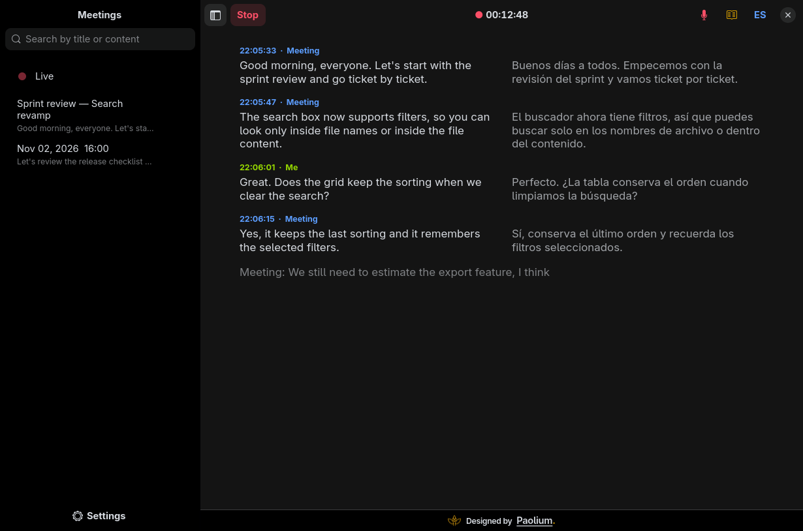
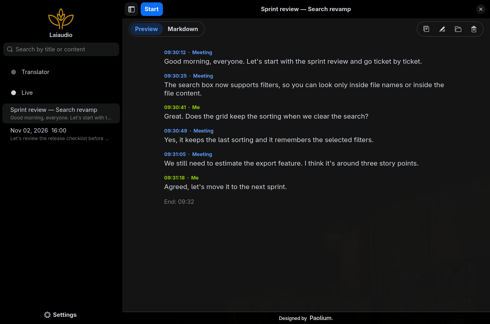
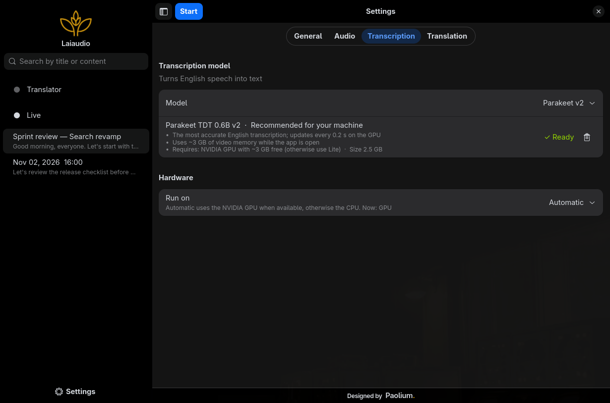

<div align="center">


# Laiaudio

**Live captions for your meetings, powered by AI that never leaves your computer.**

Real-time English transcription, an instant Spanish translation, a floating caption bar
over any app, and a clean Markdown transcript when the meeting ends.

[](LICENSE)
[](#install)
[](pyproject.toml)
[](#privacy-first)



</div>

---

## Why Laiaudio

Built-in captions in video-call apps are hit or miss, cloud transcription services read every word you say,
and most local tools wait for the speaker to pause before showing anything. Laiaudio is built to keep up with
real conversations:

- **Words appear while people speak.** Half a second from the moment a word is said to the moment you read it
  (median measured over continuous speech), with no growing delay during long meetings.
- **Understand meetings in another language.** Turn on the Spanish column and every sentence is interpreted, not
  translated word by word, by a local AI model that knows software-team jargon.
- **Never lose a meeting again.** Every session is saved as Markdown, ready to search, share or paste into your
  favorite AI assistant for a summary.
- **Your conversations stay yours.** Everything runs on your machine. No account, no cloud, no telemetry.

## Features

| | |
| --- | --- |
| **Real-time transcription** | NVIDIA Parakeet TDT 0.6B v2, one of the most accurate open English speech models, streaming every 0.2 s on the GPU. |
| **Floating captions** | A minimal two-line bar on top of any window. Drag it anywhere, on any screen; it never steals focus or clicks. |
| **Spanish translation** | Qwen3 4B or Gemma 3 4B interpret each sentence with context, in about half a second. Marian offers an instant literal mode. |
| **Text translator** | Paste Spanish to get clear, B2-level English, or English to get Spanish, with the same local AI. |
| **You and them** | Captures what plays on your computer (the meeting) and your microphone (you) as separate speakers, with echo suppression. |
| **Markdown transcripts** | One file per meeting, titled, searchable and previewable inside the app. Copy everything with one click. |
| **Hardware aware** | Detects your GPU and video memory, recommends the best combination that fits, and blocks the ones that would not. |
| **Models on demand** | Choose and download models from Settings, with clear trade-offs. Nothing to install by hand. |

<div align="center">


</div>

## Privacy first

Laiaudio was designed for work meetings, where conversations are confidential.

- **Speech recognition, translation and storage happen 100% on your computer.** Audio is processed in memory and
  never written to disk; only the text transcript is saved, in a folder you choose.
- **No internet connection is needed** once the models are downloaded. The only network traffic is the one-time
  model download from Hugging Face (and Argos for Marian).
- **No accounts, no analytics, no telemetry.** The source code is open, so you can verify every line.

## Install

Laiaudio runs on **Windows 11** and on **Arch Linux / Omarchy**. Pick your system and follow the steps; it takes a
few minutes. The AI models are downloaded from inside the app the first time you open it.

### Windows 11

1. **Download** Laiaudio: [**laiaudio-main.zip**](https://github.com/Paolium/laiaudio/archive/refs/heads/main.zip).
2. **Extract** it: right-click the ZIP in your Downloads folder → **Extract All…** → **Extract**.
3. **Install**: open the extracted `laiaudio-main` folder and double-click **`install.cmd`**.
   - If Windows says *"Windows protected your PC"*, click **More info** → **Run anyway**.
   - A black window shows the progress. It takes one or two minutes; when it says *"Done"*, press any key to close it.
   - No administrator rights are needed. Windows only asks for permission once if the Microsoft Visual C++
     runtime is missing.
4. **Open** Laiaudio from the **Start menu** or the **desktop shortcut**. The first time, press **Download** to get
   the transcription model recommended for your computer.

You can delete the ZIP and the extracted folder afterwards: everything Laiaudio needs is in
`%LOCALAPPDATA%\Laiaudio` (about 2.3 GB with an NVIDIA GPU, 0.7 GB without one, plus the models). It never touches
your system Python or your PATH.

- **Update:** download the ZIP again, extract it and double-click `install.cmd`. Your meetings, settings and
  models are kept.
- **Uninstall:** **Settings → Apps → Installed apps → Laiaudio → Uninstall**.

### Arch Linux / Omarchy

Open a terminal and run:

```bash
sudo pacman -S --needed git
git clone https://github.com/Paolium/laiaudio.git
cd laiaudio
./install.sh
```

It asks for your password once, to install the system packages with pacman. Then open **Laiaudio** from your app
menu (or run `laiaudio`). The first time, press **Download** to get the transcription model recommended for your
computer.

Keep the `laiaudio` folder: you use it to update and uninstall.

- **Update:** in the `laiaudio` folder, run `git pull && ./install.sh`.
- **Uninstall:** in the `laiaudio` folder, run `./uninstall.sh`.

When uninstalling, on both systems, it asks whether to delete the downloaded models and your settings too. Your
transcripts are never deleted.

## Requirements

- **Windows 11** (64-bit Intel or AMD processor), or **Arch Linux / Omarchy** with **PipeWire** for audio (the
  default).
- **Best with an NVIDIA GPU (6 GB+).** Laiaudio is optimized for NVIDIA: transcription runs on the GPU with the most
  accurate model, and with 8 GB the translation AI runs there too. AMD, Intel and machines without a dedicated GPU
  are supported with the Lite model on the CPU.
- Free disk space: about 8 GB with an NVIDIA GPU and the full models, 2 GB with the Lite model and Marian.
- Floating captions: on Windows they float above every window and let your clicks pass through. On Linux they are a
  true overlay on Hyprland, Sway and KDE Plasma (layer-shell) and an always-on-top window on GNOME and X11 desktops.
  Laiaudio picks the right one.

### What the installers do

- `install.cmd` runs `install.ps1`: a private Python 3.14, the official llama.cpp Vulkan build, the Python
  environment, the native Windows app (built on your machine with a .NET SDK that it removes afterwards), Start menu
  and desktop shortcuts, and an entry in **Settings → Apps** to uninstall it.
- `install.sh` installs the system packages with pacman (GTK4, libadwaita, gtk4-layer-shell, PipeWire tools and
  llama.cpp with Vulkan), creates the Python environment in `~/.local/share/laiaudio` and adds the app to your menu.

## Usage

1. Press **Start** when the meeting begins. Captions appear in the window and on the floating bar.
2. Toggle **ES** to add the Spanish column. Toggle the microphone to include or exclude your own voice.
3. Press **Stop**. The transcript is saved as `~/Documents/Laiaudio/YYYY-MM-DD_HH-MM.md`.
4. Browse past meetings in the sidebar: search, rename, preview, copy or delete them.

Use headphones when you can: with speakers, your microphone may pick up the meeting audio.

## Models and hardware

| Model | Size | Runs on |
| --- | --- | --- |
| Parakeet TDT 0.6B v2 | 2.5 GB | NVIDIA GPU with ~3 GB of free video memory |
| Parakeet TDT 0.6B v2 Lite | 660 MB | Any PC (CPU): AMD, Intel, Apple Silicon (Asahi Linux) or NVIDIA without enough VRAM |
| Qwen3 4B (translation) | 2.5 GB | GPU with ~2.5 GB free (NVIDIA, AMD or Intel) |
| Gemma 3 4B (translation) | 2.5 GB | GPU with ~2.5 GB free (NVIDIA, AMD or Intel) |
| Marian (literal translation) | 90 MB | Any PC (CPU) |

| Your machine | Recommended |
| --- | --- |
| NVIDIA with 8 GB | Parakeet v2 + Qwen3 4B |
| NVIDIA with 6 GB | Parakeet v2 + Marian, or Parakeet v2 Lite + Qwen3 4B |
| NVIDIA with 4 GB | Parakeet v2 Lite + Marian |
| AMD with 8 GB | Parakeet v2 Lite + Qwen3 4B |
| No dedicated GPU | Parakeet v2 Lite + Marian |

Rule of thumb: with NVIDIA, the full Parakeet v2 runs on the GPU whenever its video memory allows; otherwise the
Lite model runs on the CPU. On an Intel Core i7-9700 (2019) the Lite model keeps up in real time and differs from
the full model in only 0.7 % of the words.

## FAQ

**Which languages does it support?** English speech, with an optional Spanish translation.

**Does it work with Zoom, Teams, Google Meet…?** Yes. Laiaudio listens to whatever plays on your computer, so it
works with any app or browser, and with videos too.

**Which systems are supported?** Windows 11 and Arch Linux / Omarchy. Other Linux distributions are not
supported yet.

**Is the Windows version different?** It has the same pages, models, settings and rules, and the same engine. Its
window is a native Windows 11 app (WinUI 3): Windows' own title bar buttons and Snap Layouts, native controls,
ClearType text and GPU drawing, with the same Paolium colors. On Linux it is a GTK and libadwaita app.

**Can I use it on macOS?** Not yet.

**Where are my files?** Transcripts in `~/Documents/Laiaudio/` (configurable), settings in
`~/.config/laiaudio/`, models in `~/.local/share/laiaudio/models/` and the log in `~/.cache/laiaudio/app.log`.
On Windows: transcripts in `Documents\Laiaudio`, settings in `%APPDATA%\Laiaudio`, and models and the log
(`app.log`) in `%LOCALAPPDATA%\Laiaudio`.

## Contributing

Issues and pull requests are welcome. Read [`AGENTS.md`](AGENTS.md) for the engineering rules and the docs map.

## License

[MIT](LICENSE) © 2026 Paolium.

<div align="center">

<sub>Designed by <a href="https://paolium.web.app/"><b>Paolium</b></a>. Thoughtfully designed. Built to work.</sub>

</div>
